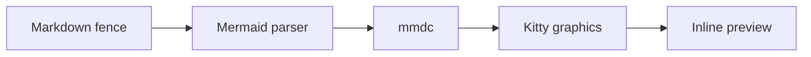

# Kitty and Mermaid cheat sheet

`kitty_mod` is `Ctrl+Shift`. Regolith and i3 use `Mod+Enter` to open Kitty.

## Everyday shortcuts

- `Ctrl+Shift+C` / `Ctrl+Shift+V`: copy / paste
- `Ctrl+Shift+Enter`: open a new Kitty window (split)
- `Ctrl+Shift+[` / `Ctrl+Shift+]`: focus the previous / next window
- `Ctrl+Shift+T`: open a tab
- `Ctrl+Shift+Left` / `Ctrl+Shift+Right`: change tabs
- `Ctrl+Shift+W`: close the current window
- `Ctrl+Shift+H`: browse scrollback in a pager
- `Ctrl+Shift+=` / `Ctrl+Shift+-`: increase / decrease font size
- `Ctrl+Shift+Backspace`: reset font size
- `Ctrl+Shift+F5`: reload `kitty.conf`

Kitty uses multi-key shortcuts for terminal hints:

- `Ctrl+Shift+P`, then `F`: select and insert a path
- `Ctrl+Shift+P`, then `Shift+F`: select and open a path
- `Ctrl+Shift+P`, then `N`: open a detected `file:line`

## Useful kittens

```bash
kitten themes                 # choose a theme interactively
kitten icat image.png         # display an image
kitten diff old.txt new.txt   # rich side-by-side diff
kitten ssh host               # SSH with Kitty terminfo and shell integration
kitten show_key               # inspect terminal key codes
```

The audio bell is disabled in `~/.config/kitty/kitty.conf`. Press
`Ctrl+Shift+F5` in Kitty after changing that file.

## Mermaid previews in Neovim

Start Neovim inside Kitty, not in a terminal without Kitty graphics support:

```bash
kitty
nvim docs/kitty-cheatsheet.md
```

Mermaid fences render inline automatically. Put the cursor inside a diagram
and press `<Space>Mp` to open its image in a floating preview.



If the preview is missing:

1. Check `$TERM` is `xterm-kitty`.
2. Run `mmdc --version`.
3. Run `:checkhealth snacks` after Neovim has fully opened.
4. Confirm the health report says Mermaid diagrams and the Kitty graphics
   protocol are supported.

Warnings about image parsers for unrelated languages such as LaTeX, Svelte,
or Vue do not prevent Markdown Mermaid previews.
